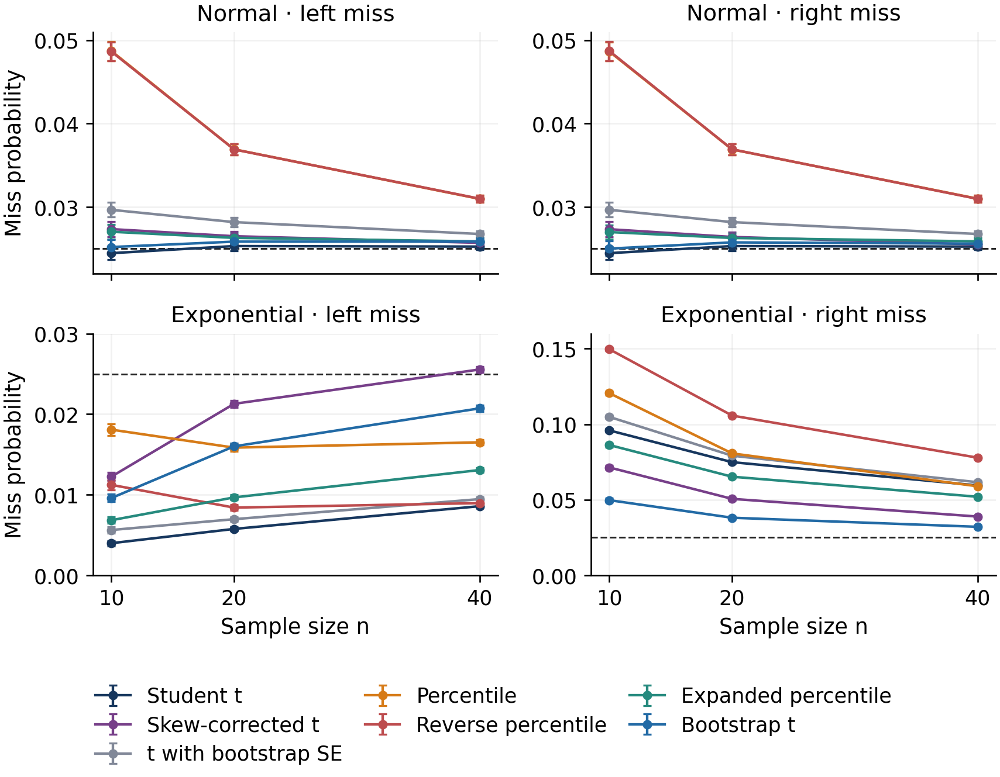

# 표본이 작을 때, 95% 신뢰구간은 얼마나 정확할까?

정규분포와 지수분포에서 일곱 가지 신뢰구간 계산법을 비교했습니다. 원 논문의 일부 실험을 독립적으로 구현했고, 별도의 표에 실린 수치 20개는 모두 표시된 자릿수까지 일치했습니다.

지수분포에서 표본이 10개인 조건의 추정 포함률은 다음과 같습니다.

| 계산법 | 추정 포함률 |
|---|---:|
| 부트스트랩 백분위수 | 86.13% |
| Student t | 90.01% |
| bootstrap-t | 94.07% |

세 방법 모두 목표는 95%입니다. 한 조건의 결과이며, 분포와 표본 수가 달라지면 비교도 달라집니다. 각 조건은 원표본 5,000회와 표본당 재추출 1,999회를 사용했습니다. 전체 추정치와 몬테카를로 오차는 공개 CSV에서 확인할 수 있습니다.

[논문과 재현 자료](https://doi.org/10.5281/zenodo.23298767) · [학술지 형식 PDF](article.pdf)
