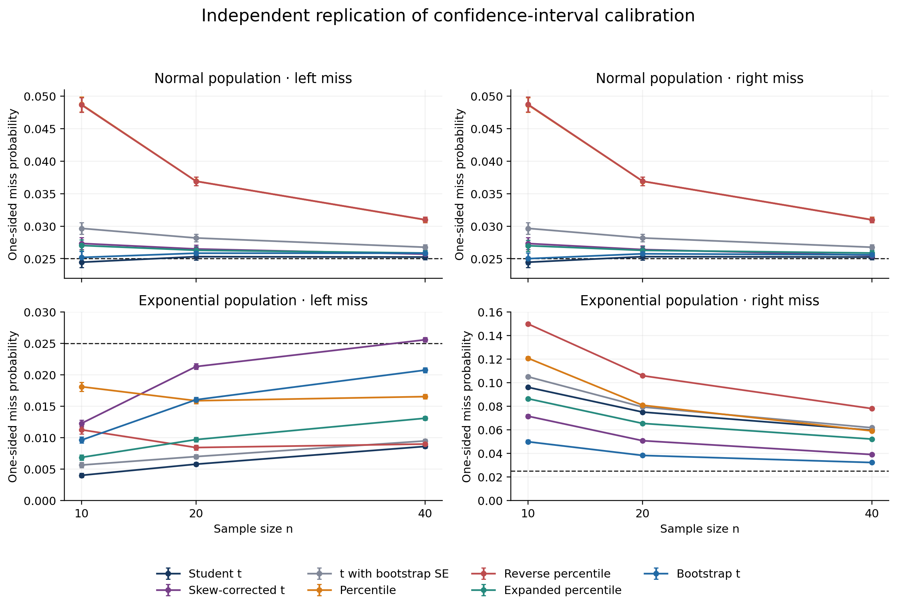
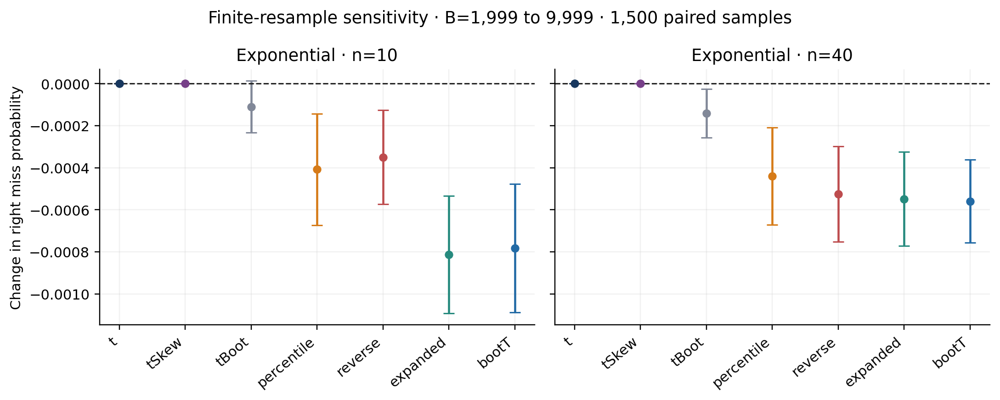

# Abstract

We independently implement seven confidence-interval procedures from
Hesterberg's study of resampling inference. All 20 printed numerical cells of
Table 5 in the extended manuscript agree with direct calculations at the
published precision. A fixed-seed experiment evaluates normal and exponential
sample means at n=10,20,40, using 5,000 original samples and 1,999 bootstrap
resamples per condition. Conditioning on centered or normalized residuals
reduces outer simulation noise. The experiment compares one-sided miss
probabilities and their Monte Carlo uncertainty, and a paired experiment
checks sensitivity to 9,999 resamples. For exponential data at n=10, bootstrap-t coverage is 0.9407, compared with 0.9001 for Student t. The largest-magnitude finite-B tail-probability change is -0.00081. The replication concerns a prespecified small-sample subset of the original study.

# Original study and target

Hesterberg (2015), Figure 10, compares one-sided miss probabilities for normal
and exponential populations. We independently implement its selected
small-sample conditions. The publicly accessible 2014 extended manuscript
provides detailed methods and exact numerical targets (Hesterberg, 2014,
2015). Table 5 and Figures 20–22 refer to that extended manuscript;
Figure 10 refers to the journal article. The exact anchor supplements the
simulation target. The interval algorithms are newly written from the equations.

# Methods

The sample mean is the parameter estimate. The seven intervals are Student
t, skewness-corrected t, t with bootstrap standard error, percentile, reverse
percentile, expanded percentile, and bootstrap t. Their endpoints are
implemented in `replicate.py`, directly from the manuscript definitions. All
variances used for Student standard errors have divisor n-1. Bootstrap
standard error uses the sample standard deviation of the B resampled means.
Empirical quantiles use linear interpolation (Hyndman–Fan type 7).

Write the sample mean as $\bar x$, its standard error as $h=s/\sqrt n$,
and $c=t_{n-1,0.975}$. For bootstrap means $\bar x_b^*$, let $Q_p$ denote
the empirical $p$ quantile, $h_B$ their sample standard deviation, and
$T_b^*=(\bar x_b^*-\bar x)/(s_b^*/\sqrt n)$. The intervals are:

| Procedure | Lower and upper endpoints |
|---|---|
| Student t | $\bar x\pm ch$ |
| t with bootstrap SE | $\bar x\pm ch_B$ |
| Percentile | $[Q_{0.025}(\bar x^*), Q_{0.975}(\bar x^*)]$ |
| Reverse percentile | $[2\bar x-Q_{0.975}(\bar x^*), 2\bar x-Q_{0.025}(\bar x^*)]$ |
| Expanded percentile | $[Q_{a_n}(\bar x^*), Q_{1-a_n}(\bar x^*)]$ |
| Bootstrap t | $[\bar x-Q_{0.975}(T^*)h,\bar x-Q_{0.025}(T^*)h]$ |

Here $a_n=\Phi(-c\sqrt{n/(n-1)})$. For the skewness-corrected t
interval define $g(q)=q+\kappa(1+2q^2)$ and
$\kappa=m_3/(6s^3\sqrt n)$, where $m_3=n^{-1}\sum_i(x_i-\bar x)^3$.
Its endpoints are $\bar x+h g(-c)$ and $\bar x+h g(c)$ after the
flattening rule below. If $\kappa>0$, arguments below $-1/(4\kappa)$
are set to that value; if $\kappa<0$, arguments above it are set to it.
The zero-skewness limit equals Student t.

The skewness correction uses $m_3/s^3$. Its quadratic is flattened at the
extremum when a nominal endpoint lies beyond it, specifying the source's
instruction explicitly. Constant resamples have undefined studentized
statistics; the implementation counts and excludes only those statistics
from bootstrap-t quantiles. It fails if fewer than 99% remain finite.

Two source populations are studied, N(0,1) and Exponential(mean=1). The six
main conditions each use 5,000 independently generated original samples and
B=1,999 resamples. The finite-B comparison uses 1,500 fresh exponential
samples at n=10 and n=40, with B=1,999 and B=9,999 sharing original samples and
the initial resample prefix. PCG64DXSM seeds are fixed before calculation.

Let a left miss mean $L>\mu$ and a right miss mean $U<\mu$.
For normal data, $\bar X$ is independent of $V=X-\bar X$, and the
intervals are translation equivariant. Conditional on $V$ and the resample
indices, $L=\bar X+L_V$ and $U=\bar X+U_V$. Since
$\bar X\sim N(0,1/n)$, the conditional probabilities are

$$p_L(V)=\Phi(\sqrt n L_V),\qquad p_R(V)=\Phi(-\sqrt n U_V).$$

For exponential data, $V=X/\bar X$ is independent of
$\bar X\sim\operatorname{Gamma}(\text{shape}=n,\text{scale}=1/n)$ and the intervals are positively
scale equivariant. Thus $L=\bar X L_V$ and $U=\bar X U_V$. If $G_n$
is the CDF of that gamma law, the conditional probabilities are

$$p_L(V)=1-G_n(1/L_V),\qquad p_R(V)=G_n(1/U_V),$$

when the corresponding residual endpoint is positive. For $L_V\le0$ the
left probability is zero; for $U_V\le0$ the right probability is one.
We average these conditional weights over independent residual vectors and
independently drawn resample indices. The law of total expectation gives
the same unconditional miss probability as binary simulation, while
conditioning removes the sample-mean component of Monte Carlo variance.

Reported Monte Carlo standard errors are the sample standard deviation of
the conditional weights divided by sqrt(R); pointwise 95% intervals use a
Student critical value with R-1 degrees of freedom. Paired B differences use
the standard error of within-sample differences and the normal critical
value 1.96. These intervals quantify
outer simulation uncertainty at the specified B. The separate paired
experiment assesses finite-B sensitivity. Prespecified sample sizes cover
three small-sample conditions.

For descriptive comparisons we use
$E=|p_L-0.025|+|p_R-0.025|$. This operationalizes the source's qualitative
statement about overall coverage accuracy; the source does not specify this
particular loss function. Individual tail estimates and their uncertainty
remain the primary simulation results.

# Results

All 20/20 numerical targets in Table 5 agree at their printed precision. The full values and discrepancies are available in `table5_comparison.csv`.

For the deterministic anchor, let $d_n=\sqrt{(n-1)/n}$ and
$z=\Phi^{-1}(0.975)$. The four calculated quantities are $d_n$,
$z/c$, $1-F_{t_{n-1}}(zd_n)$, and $\Phi(-c/d_n)$, respectively.
The following table reports our calculations with more digits than the
source's three or four decimal places.

| n | Narrowness | z/t | One-sided size | Adjusted alpha/2 |
|---:|---:|---:|---:|---:|
| 5 | 0.894427 | 0.705926 | 0.077233 | 0.000954 |
| 10 | 0.948683 | 0.866414 | 0.047954 | 0.008551 |
| 20 | 0.974679 | 0.936427 | 0.035651 | 0.015881 |
| 40 | 0.987421 | 0.968988 | 0.030114 | 0.020258 |
| 80 | 0.993730 | 0.984684 | 0.027503 | 0.022588 |

The exponential experiment gives the following newly computed results. A nominal 95% interval has target left and right miss probabilities of 0.025 each.

| n | Method | Left miss | Right miss | Coverage | MC SE, left | MC SE, right |
|---:|---|---:|---:|---:|---:|---:|
| 10 | Student t | 0.0040 | 0.0959 | 0.9001 | 0.00017 | 0.00060 |
| 10 | Skew-corrected t | 0.0122 | 0.0714 | 0.9163 | 0.00027 | 0.00068 |
| 10 | t with bootstrap SE | 0.0056 | 0.1049 | 0.8895 | 0.00021 | 0.00063 |
| 10 | Percentile | 0.0181 | 0.1206 | 0.8613 | 0.00036 | 0.00074 |
| 10 | Reverse percentile | 0.0112 | 0.1497 | 0.8391 | 0.00032 | 0.00059 |
| 10 | Expanded percentile | 0.0068 | 0.0863 | 0.9069 | 0.00021 | 0.00066 |
| 10 | Bootstrap t | 0.0096 | 0.0497 | 0.9407 | 0.00024 | 0.00074 |
| 20 | Student t | 0.0058 | 0.0749 | 0.9193 | 0.00014 | 0.00044 |
| 20 | Skew-corrected t | 0.0213 | 0.0506 | 0.9281 | 0.00023 | 0.00046 |
| 20 | t with bootstrap SE | 0.0070 | 0.0792 | 0.9138 | 0.00016 | 0.00045 |
| 20 | Percentile | 0.0158 | 0.0807 | 0.9034 | 0.00024 | 0.00051 |
| 20 | Reverse percentile | 0.0084 | 0.1058 | 0.8858 | 0.00019 | 0.00044 |
| 20 | Expanded percentile | 0.0097 | 0.0653 | 0.9250 | 0.00017 | 0.00046 |
| 20 | Bootstrap t | 0.0160 | 0.0381 | 0.9459 | 0.00021 | 0.00049 |
| 40 | Student t | 0.0086 | 0.0595 | 0.9319 | 0.00013 | 0.00031 |
| 40 | Skew-corrected t | 0.0255 | 0.0389 | 0.9355 | 0.00019 | 0.00031 |
| 40 | t with bootstrap SE | 0.0095 | 0.0616 | 0.9289 | 0.00014 | 0.00032 |
| 40 | Percentile | 0.0165 | 0.0589 | 0.9246 | 0.00018 | 0.00035 |
| 40 | Reverse percentile | 0.0090 | 0.0779 | 0.9131 | 0.00015 | 0.00032 |
| 40 | Expanded percentile | 0.0131 | 0.0520 | 0.9349 | 0.00015 | 0.00033 |
| 40 | Bootstrap t | 0.0207 | 0.0321 | 0.9472 | 0.00019 | 0.00033 |

At n=10, Bootstrap t has the smallest point-estimated sum of absolute one-sided calibration errors (0.0401). At n=20, Bootstrap t has the smallest point-estimated sum of absolute one-sided calibration errors (0.0221). At n=40, Bootstrap t has the smallest point-estimated sum of absolute one-sided calibration errors (0.0114).

For exponential data at n=10, the bootstrap-t right miss probability is 0.0497 (95% Monte Carlo interval [0.0483, 0.0512]), compared with 0.0959 for Student t. Their total coverages are 0.9407 and 0.9001, respectively. Bootstrap t ranks first here while retaining appreciable right-tail error relative to the 0.025 target.

For normal data, all three Student-t estimates have Monte Carlo intervals containing their exact one-sided probability of 0.025. Bootstrap-t miss estimates at n=20 and n=40 are slightly above the nominal target; their pointwise intervals and the percentile undercoverage are shown below and in the comparison ledger.

The largest-magnitude finite-B point change is -0.00081 (expanded_B9999_minus_B1999, n=10, right tail; paired 95% Monte Carlo interval [-0.00109, -0.00053]). All paired differences are reported in `paired_comparisons.csv`.

The run recorded 0 degenerate studentized resamples and 57 skewness-flattening events across the main and sensitivity calculations. The latter count includes the same sensitivity original samples once per B. The primary experiment took 731.6 seconds.

# Interpretation and scope

The deterministic anchor is reproduced at source precision. The simulation
comparison provides independent small-sample evidence about the original
interval-calibration conclusions. The original curves are supplied as
figures without tabulated ordinates. `table5_comparison.csv` contains the
exact numerical anchor. `original_results_comparison.csv` distinguishes
theoretical Student-t probabilities, nominal calibration targets and
qualitative ranking checks. Point-estimate rankings are
descriptive, and the Monte Carlo intervals are pointwise.

We explicitly reduce R and B relative to the source and quantify both outer
uncertainty and finite-B sensitivity. The target is the selected small-sample
regime. The large-n cutoffs in extended Figure 22, second-order convergence
rates and dependent, discrete or heavy-tailed populations require separate
experiments. The conditioning argument uses the stated normal and exponential
distributional assumptions.

# Reproducibility

Python 3.12 and the pinned requirements suffice. `python run_all.py` generates
all numerical results; `python analyze.py` creates this article and figures.
The numeric source trace, seeds, versions, per-condition timings and failure
counts are supplied. All main and finite-B conditional weights are archived in
`conditional_miss_samples.npz`, allowing independent reanalysis. The source
paper and figures are linked in `SOURCE_TRACE.md`. All observations are
generated from the stated probability distributions.

# References

Hesterberg, T. C. (2015). What Teachers Should Know About the Bootstrap:
Resampling in the Undergraduate Statistics Curriculum. *The American
Statistician*, 69(4), 371–386.
[doi:10.1080/00031305.2015.1089789](https://doi.org/10.1080/00031305.2015.1089789).

Hesterberg, T. (2014). What Teachers Should Know about the Bootstrap:
Resampling in the Undergraduate Statistics Curriculum. Extended manuscript,
arXiv:1411.5279v1. [Version 1](https://arxiv.org/abs/1411.5279v1).
